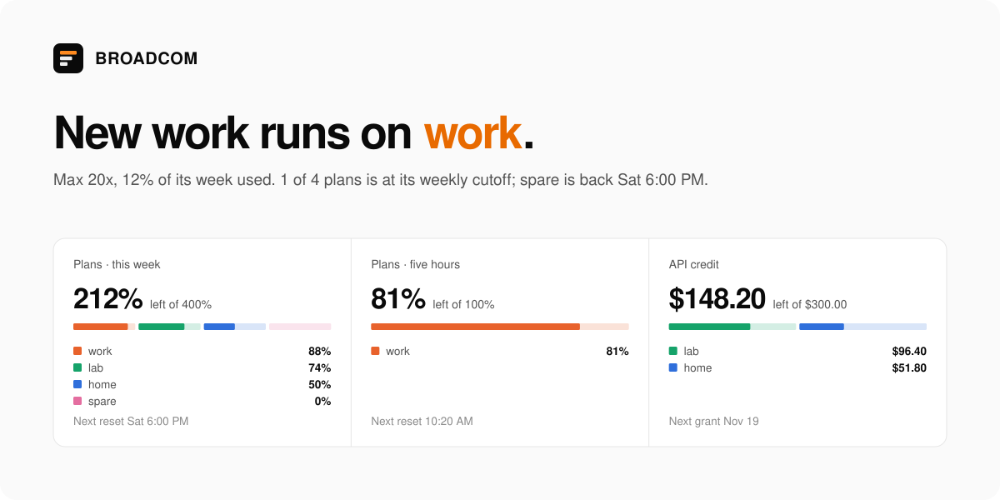

<picture>
  <source media="(prefers-color-scheme: dark)" srcset=".github/assets/banner-dark.svg">
  
</picture>

**BROADCOM** is a dashboard for a pool of Claude and ChatGPT accounts behind [CLIProxyAPI](https://github.com/AVGVSTVS96/CLIProxyAPI). It shows which account takes the next request, what is left on every plan and API credit, and whether each plan will last until it resets.

It builds to one HTML file that the proxy serves at `/management.html`.

## Pages

| Page | What it shows |
| --- | --- |
| **Home** | Who takes new work, what is left per pool, each plan's pace against its reset, and every login's limits |
| **Accounts** | One card per account with its week, held resets, and sign-in for new Claude and ChatGPT accounts, from any device |
| **Usage** | API value, activity and each account's week over a chosen range, split by agent |
| **Live** | Running sessions by channel and account, and the day's starts |
| **Routing** | Priority tiers and failover between credentials |
| **Logs** | Request logs with search and error downloads |
| **Workspace** | Files (repos, worktrees, diffs, commits), Claude plugins (MCP servers, skills, hooks) and Executor apps |
| **Config** | Providers, auth files, plugins and the proxy's settings, visually or as YAML with a diff before saving |

Home, Accounts, Usage, Live and Workspace read the fork's `/deck` API. Workspace also needs a workspace set up in the proxy's config.

## Run it

Build it, then hand the file to the proxy:

```bash
bun install --frozen-lockfile && bun run build
cp dist/index.html <proxy config dir>/static/management.html
```

In the proxy's `config.yaml`, set `management.disable-auto-update-panel: true`, or the proxy swaps the file for the upstream panel. Then open `http://<host>:8317/management.html` and sign in with the management key. Client keys in `access.api-keys` are for proxy requests and don't open the dashboard.

## Develop

Uses **Bun 1.4.3**.

```bash
bun install --frozen-lockfile
bun run dev        # http://localhost:5173, then connect to your proxy
bun run verify     # tests, lint and build
bun run build      # dist/index.html, everything inlined
```

React 19, TypeScript, Vite, Zustand and SCSS modules. Conventions for people and agents are in [AGENTS.md](AGENTS.md).

## Security

The management key controls the proxy. With **Remember password** on, the browser stores it obfuscated, not encrypted, so use a device you trust.

## Credits

Forked from [Cli-Proxy-API-Management-Center](https://github.com/router-for-me/Cli-Proxy-API-Management-Center) by Router-For.ME, which still powers the settings, provider and log pages. [MIT](LICENSE).
